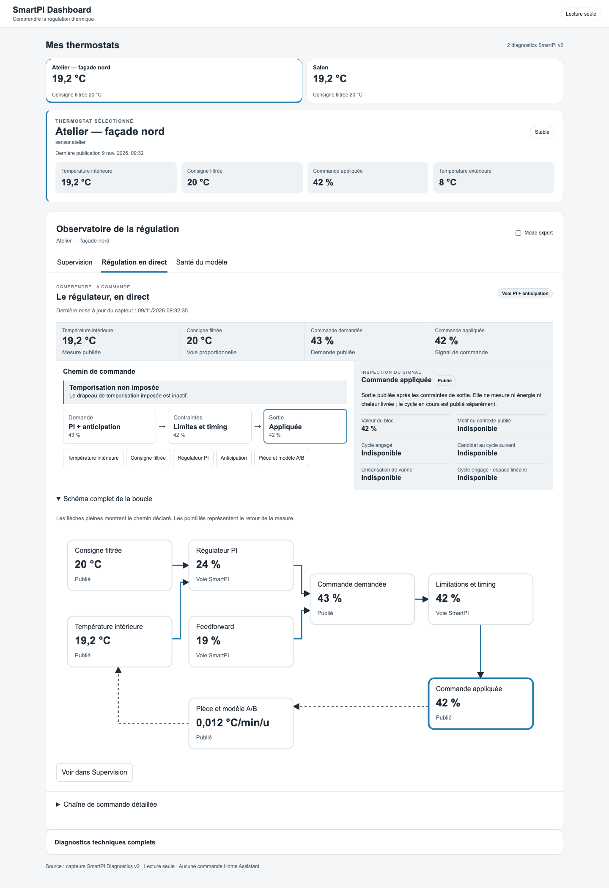
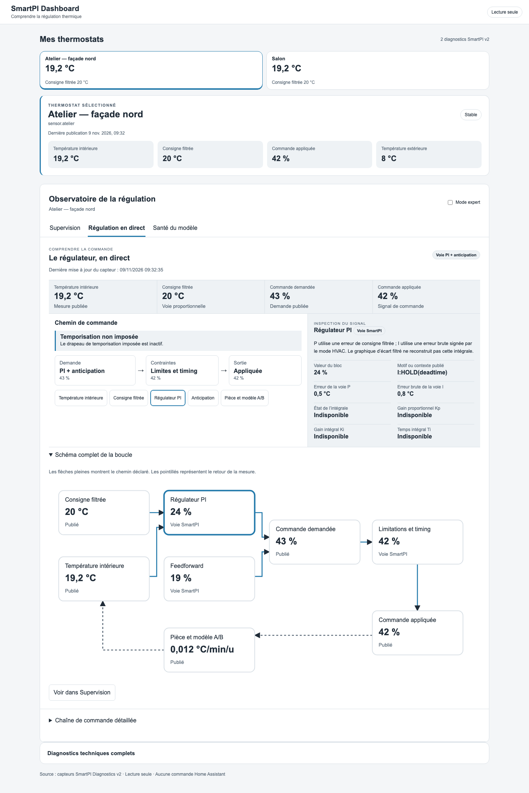
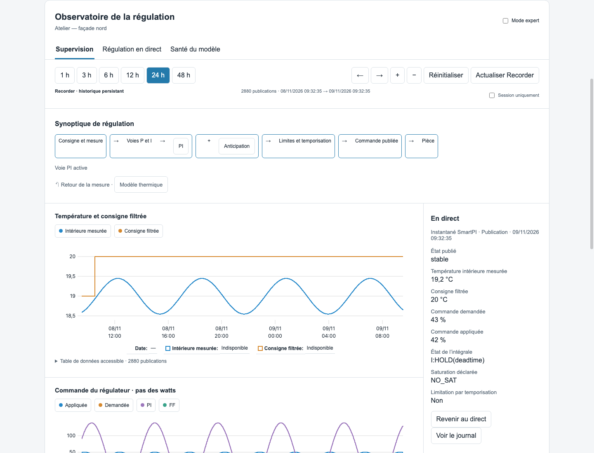

# SmartPI Dashboard

Panneau de supervision SmartPI pour Home Assistant, avec sélection explicite de température et de preset.

[English setup guide](README.en.md) · [Historique complet](CHANGELOG.md) · [Préparation Marketplace](docs/MARKETPLACE.md)

## Aperçu

Ces captures utilisent uniquement des données de démonstration synthétiques.

**Schéma complet de la boucle** : visualisez le chemin de commande et le retour de mesure.



**Inspection d’un bloc** : sélectionnez le régulateur PI pour examiner les signaux publiés.



**Supervision** : consultez le synoptique et les tendances historiques.



## Principes
- Deux actions explicites : température et preset du thermostat sélectionné, via les services climate officiels.
- Aucun changement automatique, planning, calibration ou réglage du régulateur.
- Découverte automatique des capteurs SmartPI Diagnostics (schéma v2).
- Résumé simple puis explications détaillées dépliables.
- Les valeurs absentes ou non fiables ne sont jamais présentées comme certaines.
- Aucun jeton API, serveur Flask ou entité HA supplémentaire.

## État du développement

**Version de travail 0.3.3** — panneau natif avec graphiques température/consigne, commandes,
écart filtré et modèle A/B sur 1–48 h. Zoom, déplacement, curseurs synchronisés,
légende interactive, tables accessibles, schéma logique cliquable et chaîne U.
Le trajet thermique réunit température mesurée, consigne brute du thermostat et presets publiés.
Une flèche au-dessus de la règle représente la commande appliquée ; un chevron
distinct indique le retour visé lorsqu’une température dépasse la consigne.
La sélection reste un aperçu jusqu’à **Appliquer**. Les changements reçus de Home Assistant
annulent un choix devenu obsolète ; les plannings restent gérés à l’extérieur du panneau.
L’ETA est affiché uniquement quand le Twin et son délai publié sont disponibles,
fiables et récents. Il décrit un meilleur cas, sans prédiction pour un preset en aperçu.

**Mon observatoire** ajoute quatre vues : reçus de commande, souvenirs de confort,
essais descriptifs et carnet prospectif du Twin. « Qui a la main ? » reprend les
priorités publiées ; les conseils apparaissent avant validation d’un choix.
Un souvenir prépare une température à valider. Un essai observe le réglage déjà
actif et permet de noter son ressenti, sans changer la régulation.

Le carnet reste local à Home Assistant, même panneau fermé. Son API est réservée
aux administrateurs. Conservation par pièce : 48 h / 1 200 points récents,
50 reçus, 50 essais et 100 prévisions sur 30 jours ; 30 souvenirs jusqu’à suppression.
Le fichier est privé et les écritures sont atomiques. Les sauvegardes demandées
depuis le panneau sont confirmées par relecture ; un délai dépassé reste un
résultat incertain, sans renvoi automatique. Les données se suppriment depuis le panneau. Aucun historique Twin passé n’est
reconstruit. Un délai annoncé reste un meilleur cas et une évolution mesurée
ne prouve pas qu’elle a été causée par le chauffage.

Les vues Supervision, Régulation en direct, Santé du modèle et Apprentissage
proposent un mode expert.
Un nuage écart filtré / commande complète Supervision. Régulation compare
la demande et la sortie dans la période observée ; Santé du modèle ajoute
le parcours des couples A/B publiés. La sélection clavier et les tables
complètent ces vues, avec les lacunes et limites de couverture explicites.
La vue Supervision relie le synoptique, le journal et les tendances à un
inspecteur de publications. Elle indique le nombre de couples valides et décrit l’écart à la
consigne filtrée sur les publications de la fenêtre sélectionnée.
En direct, un bandeau réunit la mesure, la consigne filtrée et les deux
commandes. Le chemin actif, le motif publié et les cycles se lisent dans
l’inspecteur. « Voir dans Supervision » recherche la même publication dans la
source et la fenêtre affichées.
Le schéma relie chaque bloc aux signaux et motifs publiés, dont les erreurs P et I,
les gains, l’anti-windup et les contraintes de cycle.

### Suivre l’apprentissage

En haut de la pièce sélectionnée, deux barres suivent les mesures A et B
conservées par SmartPI jusqu’à l’objectif publié, actuellement 31 par coefficient.
Le premier palier de 5 mesures reste indiqué après le bootstrap. Le panneau
affiche aussi l’étape, la confiance publiée du modèle, les temps morts fiables
ou attendus, le délai de réponse et les derniers motifs d’apprentissage.

Dans l’onglet **Apprentissage**, la température et la consigne filtrée partagent
la plage temporelle avec la commande appliquée. Le fond orange indique une
hausse de température entre deux mesures, le bleu une baisse. Les compteurs
historiques disponibles alimentent également un graphe de collecte A/B.

Les repères A/B distinguent les mesures collectées des mises à jour acceptées.
Leur date correspond à la publication ou à l’observation, et leur détail précise
l’intervalle entre publications. Deux repères à la même date peuvent couvrir
des apprentissages survenus à des instants différents. Les repères chauffe et
refroidissement montrent les détections observées ou les changements de médiane
fiable publiés par SmartPI.

Le Recorder standard conserve les courbes sans les compteurs ni les temps morts.
Lorsque ces champs historiques manquent, le panneau l’indique et propose
**Observer les prochains apprentissages en session**. Cette observation commence
avec les diagnostics reçus pendant l’ouverture du panneau. Les bornes physiques
des épisodes de temps mort restent indisponibles dans le schéma public.

Les pourcentages décrivent le remplissage de l’historique. La confiance du modèle
et les drapeaux de fiabilité sont affichés séparément.

Lecture Recorder via la session authentifiée de Home Assistant ; repli explicite
sur un historique de session en mémoire si les données sont absentes ou refusées.
Les diagnostics techniques de la version 0.1 restent accessibles.
Voir [VISUAL_DIAGNOSTICS.md](VISUAL_DIAGNOSTICS.md) pour les sources, la fidélité
au code SmartPI, l'architecture et les limites scientifiques.

## Prérequis

- Home Assistant **2026.11.0 minimum** ; la 0.3.2 est testée localement avec
  HA 2026.11.0 et installée sur HA 2026.11.1.
- SmartPI installé et des capteurs Diagnostics exposant `schema_version: 2`,
  `live` et `history`. Le panneau ne remplace pas l’intégration du thermostat.
- Compte administrateur pour le panneau et son carnet local.
- Recorder est facultatif : sans historique exploitable, le panneau propose
  l’observation de session, explicitement séparée des données Recorder.

## Installation

[](https://my.home-assistant.io/redirect/marketplace_repository/?owner=gael1980&repository=smartpi-dashboard&category=integration)

[](https://my.home-assistant.io/redirect/config_flow_start/?domain=smartpi_dashboard)

Les sources 0.3.3 sont publiées sur `main`, sans tag ni release GitHub créée par
ce push. Le lien Marketplace permet d’ajouter le dépôt personnalisé ; le projet
n’est pas encore dans le catalogue par défaut. Consulter les contrôles GitHub
Actions avant installation et le [bilan de diffusion](docs/MARKETPLACE.md).

Avec Home Assistant 2026.11 ou une version ultérieure, ajouter ce dépôt comme
dépôt personnalisé de type **Intégration** dans **Paramètres → Marketplace**,
puis le télécharger. Cette méthode nécessite que le dépôt soit public et ne
signifie pas qu'il est référencé dans le catalogue par défaut.

Après le téléchargement, ajouter **SmartPI Dashboard** dans **Paramètres →
Appareils et services → Ajouter une intégration**, puis ouvrir le panneau dans
la barre latérale (administrateurs seulement). Un redémarrage est nécessaire
après une mise à jour d'une intégration déjà chargée.

Installation manuelle :

1. Dans `frontend`, exécuter `npm install && npm run build`.
2. Copier `custom_components/smartpi_dashboard/` (incluant le bundle généré dans `frontend/`) vers le dossier `config/custom_components/smartpi_dashboard/` de Home Assistant.
3. Redémarrer Home Assistant, puis **Paramètres → Appareils et services → Ajouter une intégration → SmartPI Dashboard**.
4. Ouvrir **SmartPI Dashboard** dans la barre latérale (administrateurs seulement).

Les fichiers du composant et le bundle doivent être livrés ensemble, depuis la
même version. Le carnet est stocké dans `.storage`, hors du dossier remplacé
par une mise à jour ; une sauvegarde Home Assistant reste recommandée avant mise à jour.

La compilation nécessite Node.js 22+. Rien à installer sur le serveur HA après compilation.
Le transport Recorder a été vérifié en lecture seule sur HA 2026.11.0.

## Développement

```bash
cd frontend
npm install
npm run typecheck
npm test
npm run build
```

Sources de référence :
- https://github.com/KipK/vtherm_smartpi/blob/master/documentation/en/diagnostics.md
- https://github.com/gael1980/smartpi-dash
- https://developers.home-assistant.io/docs/frontend/custom-ui/
- https://contributors.home-assistant.io/marketplace/guides/integrations/

## Validation avant installation

Consulter [AUDIT.md](AUDIT.md) pour les résultats, les limites et le protocole de test.
Les tests structurels se lancent avec `python3 -m unittest discover -s tests -v`.
Pour inclure les tests de cycle de vie, utiliser un environnement Python 3.14
isolé avec `homeassistant==2026.11.0` installé (sinon les tests nécessitant HA sont ignorés).
La CI exécute également ce groupe dans un job dédié.

Pour vérifier le rendu sans HA, servir la racine du dépôt avec un serveur HTTP
local et ouvrir `frontend/tests/browser.html` : uniquement des données synthétiques,
aucune connexion à Home Assistant. `window.auditResult` donne les contrôles du scénario.
Le frontend utilise `hass.states`, l’API de métadonnées `smartpi_dashboard/observatory`
et une seule commande de lecture historique
`history/history_during_period` via la connexion HA authentifiée. Les deux actions de sélection sont isolées dans
`services/climate.ts` et nécessitent une validation explicite. La liaison climate exige la référence explicite
`specific_states.regulation_diagnostics` ; les noms d'entités ne constituent pas une preuve.
Le serveur observe les états déjà publiés, sans sonder les appareils, et conserve
le carnet dans le Store natif `.storage/smartpi_dashboard.observatory`. Il ne crée
ni entité ni service de régulation.
Les valeurs non fiables sont masquées dans les champs interprétés ; le JSON brut
reste destiné à l'inspection technique et ne valide aucune estimation.

Le test navigateur V0.2 est `frontend/tests/visual-browser.html` ; il simule Recorder,
les états indisponibles et les erreurs d'autorisation. Le runner et la CI vérifient
les interactions avec Chrome isolé, sans connexion au HA principal.

Les notices des bibliothèques embarquées sont livrées dans
`custom_components/smartpi_dashboard/frontend/THIRD_PARTY_NOTICES.md`.
Le code du projet est distribué sous [licence MIT](LICENSE) ; les licences des
bibliothèques embarquées restent applicables.
